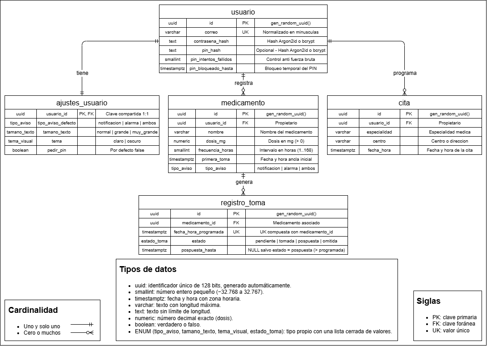

# Decisiones de diseño de la base de datos de TEMPOMEDIC

## Índice de Contenidos

- [Decisiones de diseño de la base de datos de TEMPOMEDIC](#decisiones-de-diseño-de-la-base-de-datos-de-tempomedic)
  - [Índice de Contenidos](#índice-de-contenidos)
  - [1. Alcance del documento](#1-alcance-del-documento)
  - [2. Modelo entidad-relación](#2-modelo-entidad-relación)
    - [2.1. Tipos de datos](#21-tipos-de-datos)
    - [2.2. Siglas](#22-siglas)
    - [2.3. Cardinalidad](#23-cardinalidad)
    - [2.4. Entidades y relaciones](#24-entidades-y-relaciones)
  - [3. Decisiones de diseño](#3-decisiones-de-diseño)
    - [3.1. Credenciales: hash en lugar de cifrado](#31-credenciales-hash-en-lugar-de-cifrado)
    - [3.2. Por qué Argon2id (y bcrypt como alternativa)](#32-por-qué-argon2id-y-bcrypt-como-alternativa)
    - [3.3. PIN de 4 dígitos](#33-pin-de-4-dígitos)
    - [3.4. Neon PostgreSQL como sistema gestor](#34-neon-postgresql-como-sistema-gestor)
    - [3.5. Identificadores UUID](#35-identificadores-uuid)
    - [3.6. Tipos ENUM para dominios cerrados](#36-tipos-enum-para-dominios-cerrados)
    - [3.7. Fechas y horas con `TIMESTAMPTZ`](#37-fechas-y-horas-con-timestamptz)
    - [3.8. Dosis con `NUMERIC(8,2)`](#38-dosis-con-numeric82)
    - [3.9. Tabla propia para las tomas (`registro_toma`)](#39-tabla-propia-para-las-tomas-registro_toma)
    - [3.10. Posponer una toma](#310-posponer-una-toma)
    - [3.11. Frecuencia en horas](#311-frecuencia-en-horas)
    - [3.12. Ajustes en una tabla 1:1](#312-ajustes-en-una-tabla-11)
    - [3.13. Borrado en cascada](#313-borrado-en-cascada)
  - [4. Reparto de validaciones: base de datos y app](#4-reparto-de-validaciones-base-de-datos-y-app)
  - [5. Referencias](#5-referencias)

## 1. Alcance del documento

Este documento recoge **qué se ha decidido en el diseño de la base de datos, por qué y qué limitaciones tiene**, para que el equipo pueda revisarlo y defenderlo.

---

## 2. Modelo entidad-relación

### 2.1. Tipos de datos

| Tipo | Descripción | Uso en Tempomedic |
| --- | --- | --- |
| `uuid` | Identificador único de 128 bits, generado automáticamente. | Claves primarias y foráneas (`id`, `usuario_id`…). |
| `smallint` | Número entero pequeño (−32.768 a 32.767). | `frecuencia_horas`, `pin_intentos_fallidos`. |
| `timestamptz` | Fecha y hora con zona horaria. | `primera_toma`, `fecha_hora`, `pospuesta_hasta`… |
| `varchar` | Texto con longitud máxima. | `correo`, `nombre`, `especialidad`, `centro`. |
| `text` | Texto sin límite de longitud. | `contrasena_hash`, `pin_hash`. |
| `numeric` | Número decimal exacto. | `dosis_mg`. |
| `boolean` | Verdadero o falso. | `pedir_pin`. |
| ENUM | Tipo propio con una lista cerrada de valores. | `tipo_aviso`, `tamano_texto`, `tema_visual`, `estado_toma`. |

### 2.2. Siglas

| Sigla | Significado |
| --- | --- |
| PK | Clave primaria (*Primary Key*) |
| FK | Clave foránea (*Foreign Key*) |
| UK | Valor único (*Unique Key*) |

### 2.3. Cardinalidad

| Símbolo | Significado |
| --- | --- |
| Uno y solo uno | Exactamente un registro en ese extremo de la relación. |
| Cero o muchos | Ninguno, uno o varios registros en ese extremo. |

### 2.4. Entidades y relaciones

| Entidad | Contenido |
| --- | --- |
| `usuario` | Correo, hash de contraseña, hash de PIN opcional y control de intentos fallidos. |
| `ajustes_usuario` | Aviso por defecto, tamaño de texto, tema y si se pide PIN. |
| `medicamento` | Nombre, dosis en mg, frecuencia en horas, primera toma y tipo de aviso. |
| `registro_toma` | Cada toma concreta de un medicamento, con su estado y, si procede, hasta cuándo se pospone. |
| `cita` | Especialidad, centro, fecha y hora. |

| Relación | Cardinalidad |
| --- | --- |
| `usuario` - `ajustes_usuario` | 1:1 |
| `usuario` - `medicamento` | 1:N |
| `medicamento` - `registro_toma` | 1:N |
| `usuario` - `cita` | 1:N |

---

## 3. Decisiones de diseño

### 3.1. Credenciales: hash en lugar de cifrado

**Decisión.** La contraseña y el PIN **no se guardan en claro ni cifrados**: se guarda su **hash con sal**. En el planteamiento inicial se hablaba de "cifrado". Se ha concretado como hash por los motivos siguientes.

**Motivos.**

- El **cifrado es reversible**: quien disponga de la clave puede recuperar todos los valores originales, y esa clave tiene que estar accesible para la aplicación. Si se filtra la clave junto con la base de datos, se exponen todas las contraseñas.
- Un **hash no se puede invertir**. Para comprobar una contraseña, se calcula el hash de lo que escribe el usuario y se compara con el almacenado. La aplicación nunca necesita conocer la contraseña original.
- Si la base de datos se filtra, el atacante obtiene hashes y tiene que probar candidatos uno a uno, no puede "descifrar" directamente.
- Encaja con la prioridad de privacidad de los usuarios (95 % en la encuesta propia del proyecto [4]).

### 3.2. Por qué Argon2id (y bcrypt como alternativa)

**Decisión:** Usar **Argon2id** para contraseña y PIN.

**Motivos.**

- Los hash de propósito general (por ejemplo, SHA-256) están diseñados para ser **rápidos**, y eso beneficia al atacante, que puede probar enormes cantidades de contraseñas por segundo. Para contraseñas se necesitan algoritmos **deliberadamente lentos**.
- **Argon2id** es una función de derivación que consume mucha **memoria**, lo que encarece los ataques con GPU o hardware especializado. Es la variante híbrida de la familia Argon2 y la que se recomienda cuando no hay un motivo para elegir otra [1], [2].
- La **sal** es única por usuario y viaja dentro de la propia cadena del hash junto con el algoritmo y los parámetros, por lo que **no hace falta una columna de sal aparte**. Por eso las columnas son `TEXT`: no se limita la longitud del hash.

**Alternativa: bcrypt.** Es más antiguo y está muy extendido y soportado en Java. También incluye sal y coste en su resultado. No consume memoria de forma significativa y limita la longitud de entrada (72 bytes). Sería la opción de reserva si la librería de Argon2id diera problemas de dependencias.

### 3.3. PIN de 4 dígitos

**Decisión.** El PIN es **opcional**, de 4 dígitos, y se guarda como hash (`pin_hash`, `NULL` si el usuario no lo usa).

**Problema.** Un PIN de 4 dígitos solo tiene 10 000 combinaciones. Aunque el hash sea lento, si alguien obtuviera una copia de la base de datos podría probarlas todas con relativa facilidad.

**Medidas adoptadas.**

- En base de datos: `pin_intentos_fallidos` y `pin_bloqueado_hasta`, para bloquear temporalmente tras varios fallos.
- En la aplicación Java: el PIN solo actúa como desbloqueo rápido sobre una sesión ya iniciada con correo y contraseña, nunca sustituye a la contraseña. Número de intentos y duración del bloqueo: 3 intentos, 30 seg de bloqueo. El contador se reinicia tras un acierto.

**Limitación.** El bloqueo protege frente a intentos a través de la aplicación, no frente a un ataque offline sobre un volcado de la base de datos.

### 3.4. Neon PostgreSQL como sistema gestor

- El equipo ha elegido **Neon** (PostgreSQL gestionado). Motivos de la elección: [BBDD_Elegida.md](BBDD_Elegida.md).
- El modelo es relacional (usuario -> medicamentos -> tomas; usuario -> citas) y aprovecha características de PostgreSQL: tipos `ENUM`, `TIMESTAMPTZ`, índices parciales y `gen_random_uuid()`, que es nativa desde PostgreSQL 13 [3].
- La cadena de conexión no debe subirse al repositorio (fichero de configuración ignorado en `.gitignore`) y la conexión debe usar SSL (`sslmode=require`).
- **Limitación:** La documentación previa del proyecto describía persistencia local. Al pasar a una base de datos en la nube hay que actualizar los apartados de arquitectura y de viabilidad técnica y legal (alojamiento de datos personales, RGPD) en: [memoria.md](../Proyecto/docs/memoria.md#2-análisis-del-contexto-y-viabilidad).

### 3.5. Identificadores UUID

- Todas las tablas usan `UUID` con `gen_random_uuid()` como clave primaria.
- **Motivos:** no son secuenciales, por lo que no se pueden deducir contando (no revelan cuántos usuarios hay) y se pueden generar sin coordinarse con un contador del servidor.
- **Alternativa valorada:** `BIGINT GENERATED ALWAYS AS IDENTITY` (8 bytes en lugar de 16 y mejor localidad en los índices). Con el volumen previsto, la diferencia es inapreciable.
- **Matiz:** un UUID no sustituye las comprobaciones de autorización. Toda consulta debe filtrar por el `usuario_id` de la sesión.

### 3.6. Tipos ENUM para dominios cerrados

- `tipo_aviso` (notificación, alarma, ambos), `tamano_texto` (normal, grande, muy grande), `tema_visual` (claro, oscuro) y `estado_toma` (pendiente, tomada, pospuesta, omitida).
- **Motivo:** el conjunto de valores es cerrado y una única definición (`tipo_aviso`) se reutiliza en `medicamento` y en `ajustes_usuario`.
- **Alternativa:** restricciones `CHECK` sobre columnas de texto.
- **Limitación:** Añadir un valor a un ENUM es sencillo (`ALTER TYPE ... ADD VALUE`), pero eliminar o renombrar valores exige una migración.
- Los identificadores y valores no llevan tildes ni `ñ` (`tamano_texto`, `muy_grande`) para evitar problemas de codificación con JDBC y clientes SQL. La interfaz muestra el texto correcto al usuario.

### 3.7. Fechas y horas con `TIMESTAMPTZ`

- PostgreSQL almacena el instante exacto (internamente en UTC) y lo convierte a la zona horaria de la sesión al mostrarlo, lo que evita ambigüedades entre equipos configurados con zonas distintas [3].
- En Java se corresponde con tipos como `OffsetDateTime`.
- **Limitación:** Con una pauta "cada 24 h" calculada sumando horas a un instante, el **cambio de hora verano/invierno** desplaza la hora local de la toma una hora.
- **Propuesta:** calcular las tomas en Java con `ZonedDateTime` y la zona `Europe/Madrid`. Zona horaria de referencia del proyecto: **Europe/Madrid**.

### 3.8. Dosis con `NUMERIC(8,2)`

- `NUMERIC` guarda decimales exactos (por ejemplo, 0,25 mg) sin los errores de redondeo de los tipos de coma flotante.
- `NUMERIC(8,2)` admite hasta 999 999,99 mg y dos decimales. Restricción `dosis_mg > 0`.
- **Limitación:** Solo se contempla la unidad **mg**. Otras unidades (ml, gotas, comprimidos) quedan fuera de esta versión.

### 3.9. Tabla propia para las tomas (`registro_toma`)

- `medicamento` describe la **pauta** (se repite); `registro_toma` guarda **cada toma concreta** y su estado (pendiente, tomada, pospuesta, omitida).
- Guardar el estado en `medicamento` sobrescribiría el anterior en cada toma y no habría historial. Separarlo mantiene el modelo en 3FN.
- La restricción `UNIQUE (medicamento_id, fecha_hora_programada)` impide duplicar una toma.
- **Propuesta:** Las tomas se generan a partir de `primera_toma + n * frecuencia_horas` con un alta idempotente (`INSERT ... ON CONFLICT DO NOTHING`) al abrir la vista "Hoy" o al guardar el medicamento.
- **Limitación:** Si el usuario no abre la aplicación un día, las tomas de ese día no se generan y no queda constancia de que se omitieron. Política a decidir.

### 3.10. Posponer una toma

- Se guarda la hora hasta la que se pospone en `pospuesta_hasta` (`TIMESTAMPTZ`, `NULL` salvo estado `pospuesta`).
- Un `CHECK` garantiza que `pospuesta_hasta` solo tenga valor cuando `estado = 'pospuesta'` y que sea posterior a `fecha_hora_programada`.
- Al pasar una toma a "tomada" u "omitida", la aplicación debe poner `pospuesta_hasta = NULL` en el mismo `UPDATE`, de lo contrario la base de datos rechaza la operación.
- Un índice parcial (`WHERE estado = 'pospuesta'`) permite localizar las pospuestas vencidas sin penalizar el resto.
- La duración (30 minutos o 1 hora) la decide la aplicación, no la base de datos.
- **Limitación:** Al cerrar la toma se pierde la información de que se pospuso antes.

### 3.11. Frecuencia en horas

- El equipo ha decidido "**cada X horas**" (por ejemplo, cada 48 h). En la interfaz se elegirá desde un desplegable o se escribirá a mano.
- Se guarda en `frecuencia_horas` (`SMALLINT`) y no como ENUM, porque admite valores libres.
- **Propuesta:** `CHECK (frecuencia_horas BETWEEN 1 AND 168)`: de 1 hora a 1 semana, lo que cubre las pautas habituales y frena errores de tecleo.
- **Limitación:** No cubre días concretos de la semana (por ejemplo, lunes, miércoles y viernes) ni horarios irregulares.

### 3.12. Ajustes en una tabla 1:1

- `ajustes_usuario` usa `usuario_id` como **clave primaria y foránea a la vez**, lo que garantiza la relación 1:1 en el propio motor.
- Separa credenciales de preferencias de interfaz. Los ajustes se conservan al iniciar sesión en otro equipo.
- La fila de ajustes debe crearse en la misma transacción que el usuario (lógica Java).
- `pedir_pin` y `pin_hash` están en tablas distintas: no se puede comprobar con un `CHECK` que no se active `pedir_pin` sin PIN. Debe validarse en Java (o con un *trigger*).

### 3.13. Borrado en cascada

- Todas las claves foráneas usan `ON DELETE CASCADE`: al borrar un medicamento se borra su historial de tomas y al eliminar la cuenta se borra todo lo asociado al usuario.
- **Motivos:** privacidad (95 % en la encuesta propia [4]), simplicidad del modelo y coherencia con el derecho de supresión del RGPD.
- La aplicación debe pedir **confirmación explícita** antes de borrar, porque la operación no se puede deshacer.
- **Limitación:** No hay `fecha_fin` ni indicador `activo`: un tratamiento temporal sigue generando tomas hasta que se borra a mano, y un futuro historial para informes no sería posible tras borrar. Si se necesita, bastaría añadir una columna `fecha_fin` opcional.

---

## 4. Reparto de validaciones: base de datos y app

| Ámbito | En la base de datos | En la aplicación |
| --- | --- | --- |
| Usuario | Correo único, no vacío y en minúsculas; hash no vacío; intentos ≥ 0. | Formato de correo, política de contraseña, PIN de exactamente 4 dígitos antes de calcular el hash, umbral y expiración del bloqueo. |
| Ajustes | Existencia del usuario (FK) y valores válidos de los ENUM. | Crear los ajustes con el usuario; impedir `pedir_pin = true` sin `pin_hash`. |
| Medicamento | Nombre no vacío, dosis > 0, frecuencia entre 1 y 168. | Convertir la entrada manual o del desplegable a entero, mensajes de error claros y accesibles, generación de tomas. |
| Posponer | Unicidad de la toma y coherencia entre `estado` y `pospuesta_hasta`. | Calcular `pospuesta_hasta`, limpiarlo al cerrar la toma y controlar las transiciones permitidas. |
| Citas | Especialidad y centro no vacíos. | Avisar de fechas pasadas y confirmar borrados. |

---

## 5. Referencias

- [1] A. Biryukov, D. Dinu, D. Khovratovich y S. Josefsson, «Argon2 Memory-Hard Function for Password Hashing and Proof-of-Work Applications», RFC 9106, IETF, sep. 2021. [En línea]. Disponible en: <https://www.rfc-editor.org/rfc/rfc9106>
- [2] OWASP Foundation, «Password Storage Cheat Sheet», OWASP Cheat Sheet Series. [En línea]. Disponible en: <https://cheatsheetseries.owasp.org/cheatsheets/Password_Storage_Cheat_Sheet.html>
- [3] The PostgreSQL Global Development Group, «PostgreSQL Documentation: Data Types» (UUID, enumerados, fecha/hora, numéricos). [En línea]. Disponible en: <https://www.postgresql.org/docs/current/datatype.html>
- [4] Equipo Tempomedic, «Resultados de la encuesta» (n = 66), [../Proyecto/docs/requisitos/ResultadosEncuesta.xml](../Proyecto/docs/requisitos/ResultadosEncuesta.xml). Documento propio del proyecto.
