# Tempomedic-Interfaz

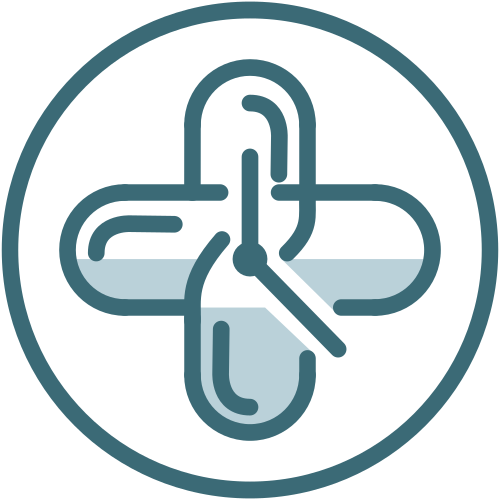

> Aplicación de escritorio en Java (Swing, patrón MVC) para gestionar medicación y citas médicas: recordatorios por notificación o alarma y registro de tomas. Proyecto Intermodular DAM, módulo Desarrollo de Interfaces (DII).


-blue)

Repositorio principal: <https://github.com/SantiagoGonzalez12/Tempomedic>

## Índice

1. [Descripción del proyecto](#1-descripción-del-proyecto)
2. [Público objetivo](#2-público-objetivo)
3. [Capturas](#3-capturas)
4. [Estructura de carpetas](#4-estructura-de-carpetas)
5. [Decisiones técnicas](#5-decisiones-técnicas)
6. [Objetivos de la interfaz (UI/UX)](#6-objetivos-de-la-interfaz-uiux)
7. [Documentación](#7-documentación)
8. [Backlog y cronograma](#8-backlog-y-cronograma)
9. [Proceso de trabajo](#9-proceso-de-trabajo)
10. [Pruebas](#10-pruebas)
11. [Resultado obtenido](#11-resultado-obtenido)
12. [Equipo](#12-equipo)

---

## 1. Descripción del proyecto

Olvidar una toma de medicación o perder de vista una cita médica es fácil cuando se combinan varios tratamientos y poco tiempo, y puede afectar gravemente a la salud. Además, pedir cita en aplicaciones públicas o de forma presencial resulta lento y frustrante para muchas personas.

**Tempomedic** centraliza medicación y citas en un solo sitio, con avisos que el usuario elige: una notificación discreta, una alarma con sonido o ambas.

**Qué incluye la interfaz (Sprint 2):**

- 10 ventanas Swing maquetadas con NetBeans Matisse a partir del diseño de Figma: Iniciar sesión, Crear cuenta, Recuperar contraseña, Bloqueo por PIN, Hoy, Medicamentos, Añadir medicamento, Citas, Pedir cita y Ajustes.
- Navegación mediante menú lateral (sidebar) con icono y texto.
- Componente visual reutilizable `TarjetaToma` para las tomas del día (estados Pendiente, Tomada y Omitida).
- Estudio de **FlatLaf** como Look and Feel (tema claro/oscuro). Su integración se pospone al siguiente sprint, así que en el Sprint 2 se mantiene el aspecto nativo de Swing (ver incidencia AUD-01 en [Pruebas](#10-pruebas)).
- Escalas de texto Normal, Grande y Muy grande, pensadas para usuarios de edad avanzada.

**Alcance previsto del producto (próximos sprints):** alta, edición y eliminación de medicamentos; recordatorios por notificación o alarma; registro e historial de tomas; petición, consulta y cancelación de citas.

**Fuera de alcance** (proyecto académico): conexión con sistemas sanitarios reales, receta electrónica y cualquier función de diagnóstico. No sustituye el criterio de un profesional sanitario.

## 2. Público objetivo

Según la encuesta realizada a los usuarios, se identifican dos grupos principales:

### 2.1. Pacientes con tratamientos temporales u ocasionales

- **Perfil:** personas jóvenes o adultas que toman medicamentos durante un periodo concreto (antibióticos, analgésicos, tratamientos de 7 a 15 días).
- **Necesidad:** alertas precisas que no dependan de recordar el horario entre tomas (por ejemplo, cada ocho horas).
- **Solución:** programación rápida de avisos con fecha de inicio y fin.

### 2.2. Pacientes crónicos o con muchos medicamentos

- **Perfil:** personas adultas o de edad avanzada que toman varios medicamentos al día y acuden a revisiones periódicas.
- **Necesidad:** evitar confusiones con dosis y horarios, y no perder las citas de seguimiento.
- **Solución:** vista diaria unificada ("Hoy") con tomas y próximas citas, y texto escalable.

## 3. Capturas

| Crear cuenta | Iniciar sesión |
| --- | --- |
| 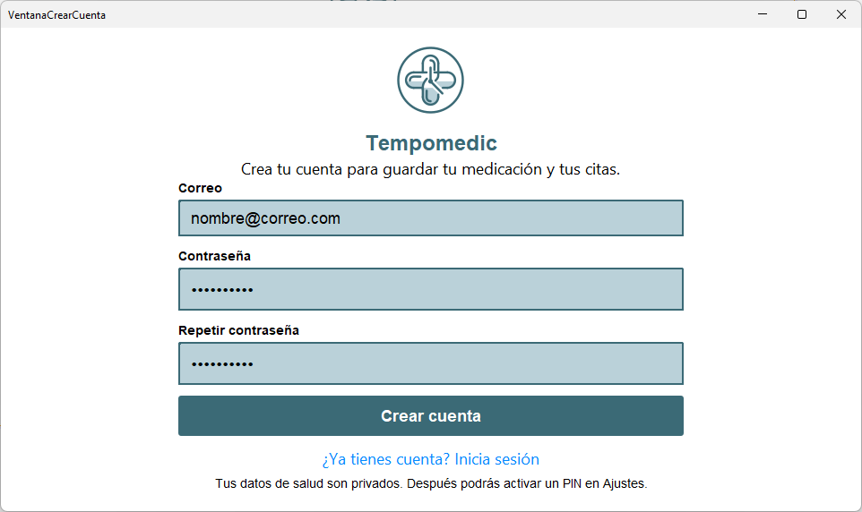 | 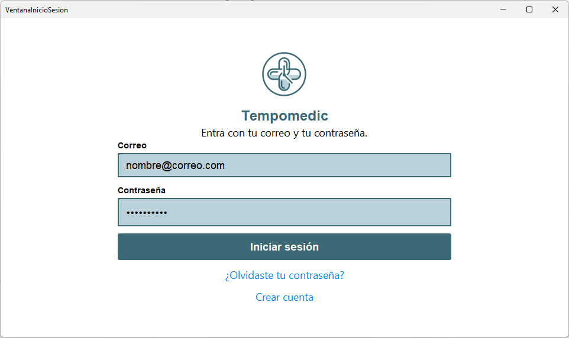 |

| Recuperar contraseña | Bloqueo por PIN |
| --- | --- |
| 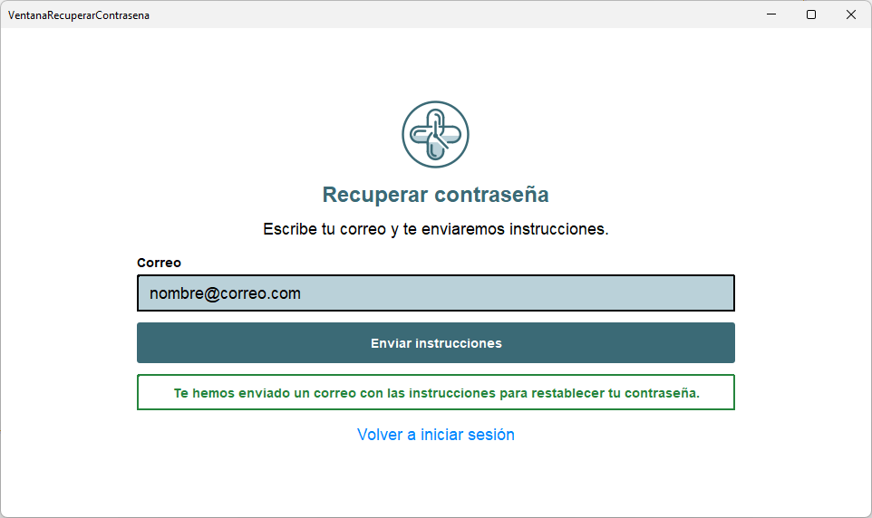 | 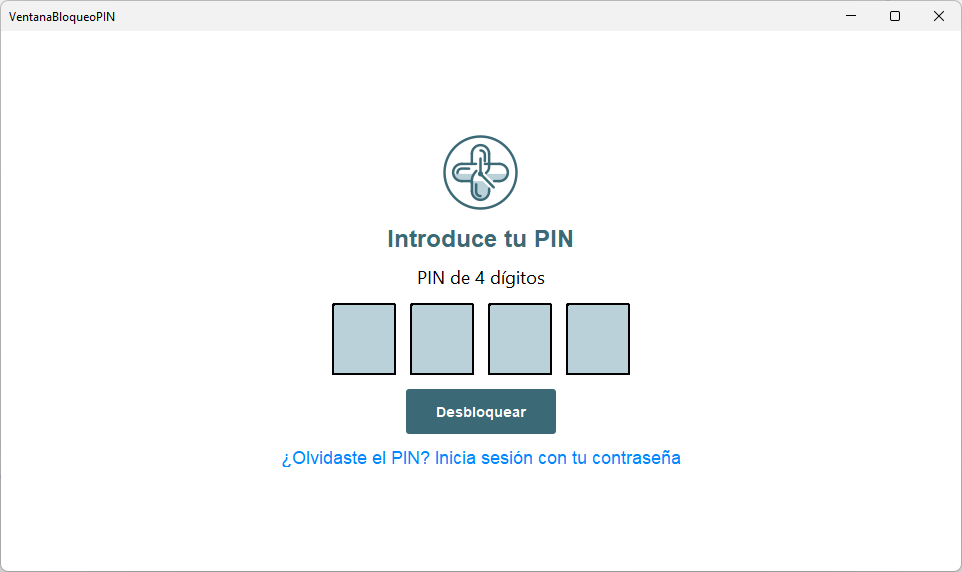 |

| Hoy | Medicamentos |
| --- | --- |
| 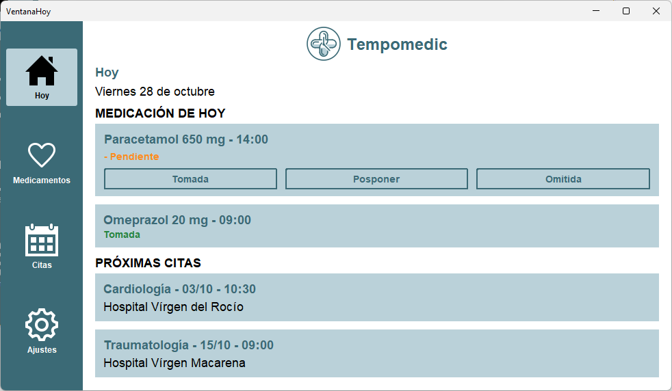 | 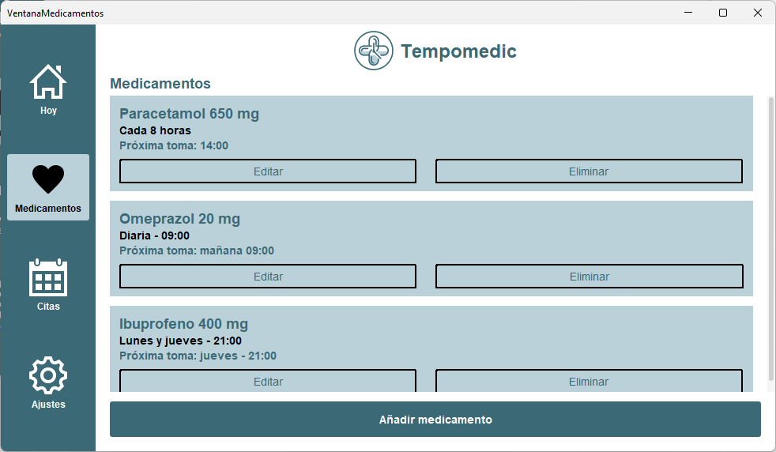 |

| Añadir medicamento | Citas |
| --- | --- |
| 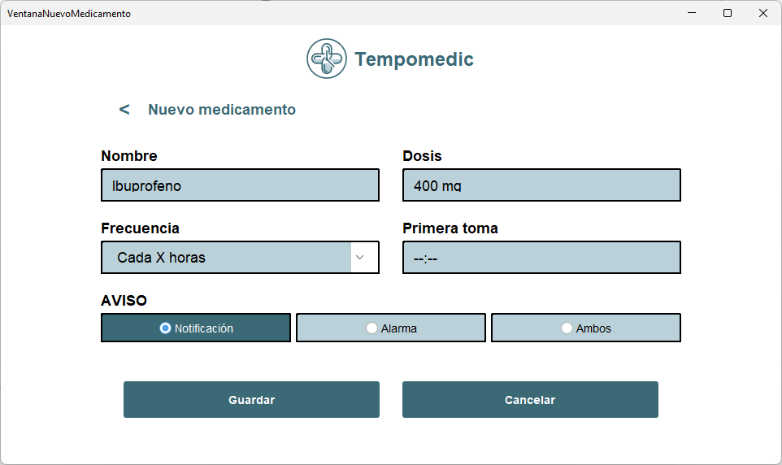 | 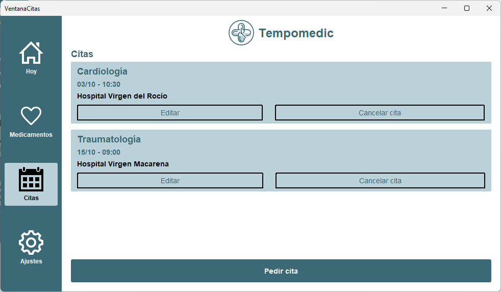 |

| Pedir cita | Ajustes |
| --- | --- |
| 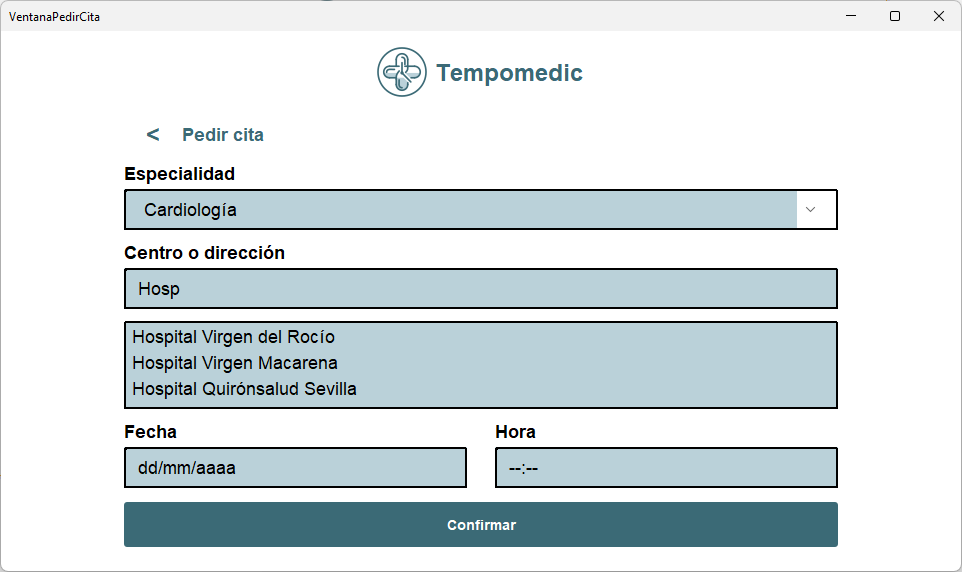 | 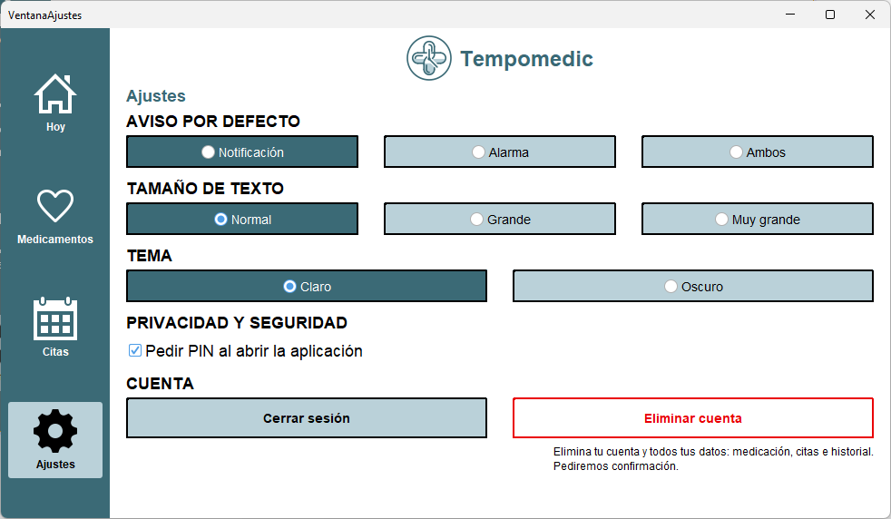 |

Los bocetos y mockups están en `docs/img/BocetosVistas` y `docs/img/mockups`, y en la [previsualización de Figma](https://www.figma.com/proto/ubk5OfKsRbFFkuf4rPfQUt/Tempomedic-%E2%80%93-Bocetos-Sprint-1?node-id=2-2&p=f&t=ziVSvWBFrGusDbKS-1&scaling=scale-down&content-scaling=fixed&page-id=0%3A1&starting-point-node-id=2%3A2&show-proto-sidebar=1).

## 4. Estructura de carpetas

```
Interfaz/
├─ docs/
│  ├─ backlogs/                 Backlogs de los sprints (backlogSprint2.md)
│  ├─ img/
│  │  ├─ Auditoria/             Evidencias de la auditoría
│  │  ├─ BocetosVistas/         Bocetos del Sprint 1
│  │  ├─ icons/                 Iconos
│  │  ├─ logo/                  Logotipo
│  │  ├─ mockups/               Mockups de Figma
│  │  ├─ ventanas/              Capturas de las ventanas
│  │  ├─ DF TempoMedic.png      Diagrama de flujo
│  │  └─ Diagrama de Gantt Sprint 2.png
│  ├─ auditoria.md              Medidas, auditoría, mensajes y pruebas SUS
│  ├─ componentes.md            Fichas de los componentes usados
│  ├─ cronograma.md             Cronograma de ejecución (Gantt)
│  ├─ diseno.md                 Cambios de diseño, paleta, tipografía y FlatLaf
│  ├─ estructura-y-flujo.md     Menús, ventanas, diálogos, atajos y mapa de navegación
│  └─ usabilidad-accesibilidad.md  Estándares y matriz de aplicación
├─ Tempomedic_App/              Proyecto NetBeans (Ant)
│  ├─ librerias/                Librerías externas (FlatLaf)
│  ├─ nbproject/
│  ├─ src/com/tempomedic/
│  │  ├─ icons/                 Iconos PNG de la interfaz
│  │  ├─ logos/                 Logotipos
│  │  └─ vista/                 Ventanas Swing (Ventana*.java y .form)
│  ├─ build.xml
│  └─ manifest.mf
├─ .gitignore
└─ README.md
```

Las ventanas del paquete `vista` son: `VentanaInicioSesion`, `VentanaCrearCuenta`, `VentanaRecuperarContrasena`, `VentanaBloqueoPIN`, `VentanaHoy`, `VentanaMedicamentos`, `VentanaNuevoMedicamento`, `VentanaCitas`, `VentanaPedirCita` y `VentanaAjustes`.

## 5. Decisiones técnicas

### 5.1. Tecnologías

| | |
| --- | --- |
| Lenguaje | Java |
| Interfaz gráfica | Swing, con el editor visual NetBeans Matisse |
| Look and Feel | Swing nativo en el Sprint 2. FlatLaf 3.7.2 previsto para el siguiente sprint |
| Arquitectura | MVC (Modelo–Vista–Controlador) |
| Proyecto | NetBeans (Ant), librerías en `librerias/` |
| Persistencia | En memoria en esta fase |
| Control de versiones | Git / GitHub, con Issues y Projects para Scrum |

### 5.2. Diseño de escritorio implementado en Swing

El diseño inicial era de móvil (vertical, con barra de navegación inferior). En el Sprint 2 se rediseñó para **escritorio**, porque Swing es una tecnología de aplicaciones de escritorio:

- Lienzo horizontal 16:9. Las ventanas se maquetan sobre una base de **960 x 540 px** de contenido y se adaptan al maximizar.
- La barra inferior se sustituye por un **menú lateral** de ancho fijo (120 px) con icono y texto: *Hoy*, *Medicamentos*, *Citas* y *Ajustes*. La sección actual se marca con fondo `#BAD1D9` y texto e icono negros.
- Los formularios (Añadir medicamento, Pedir cita) se reorganizan en columnas para aprovechar el ancho.
- Se elimina el desbloqueo por **biometría**, que no es viable en una aplicación de escritorio Swing.

La maquetación se hizo **solo con propiedades y layouts desde el diseñador de NetBeans**: GridBagLayout en tarjetas y formularios, BorderLayout para la estructura general, GridLayout para filas de botones, y `JScrollPane` en listas. No se usa AbsoluteLayout, porque no se adapta al redimensionar. El detalle de cada componente está en [`docs/componentes.md`](docs/componentes.md).

### 5.3. Patrón MVC

- **Modelo:** clases de datos (`Cita`, `Medicamento`, `Toma`).
- **Vista:** ventanas Swing del paquete `com.tempomedic.vista`, sin lógica.
- **Controlador:** gestiona los eventos de la vista y actualiza el modelo (pendiente de implementar en los próximos sprints).

### 5.4. Componente reutilizable: `TarjetaToma`

Tarjeta de toma de medicación con medicamento, dosis, hora, estado y botones *Tomada*, *Posponer* y *Omitida*. El estado se indica con **texto y símbolo, no solo con color** (Pendiente, Tomada, Omitida). Se usa en `VentanaHoy`. Su ficha está en [`docs/componentes.md`](docs/componentes.md).

### 5.5. Estilo visual

- **Paleta:** azul oscuro `#3B6A76` (marca, botones, sidebar), azul claro `#BAD1D9` (tarjetas y campos), blanco, negro, y colores de estado: azul `#0075DA` (enlaces), verde `#25853D`, naranja `#BC5800` y rojo `#EA0004`. Contrastes comprobados según WCAG en [`docs/diseno.md`](docs/diseno.md).
- **Tipografía:** Sans-Serif con tres escalas.

| Escala | Botones | Texto | Títulos |
| --- | --- | --- | --- |
| Normal | 14 pt | 18 pt | 24 pt |
| Grande | 18 pt | 22 pt | 30 pt |
| Muy grande | 22 pt | 26 pt | 36 pt |

- **Iconos:** PNG importados al tamaño final y siempre acompañados de texto.
- **FlatLaf:** elegido frente a Metal, Nimbus y librerías antiguas por su aspecto moderno, tema claro/oscuro, buen soporte HiDPI y facilidad de integración. Comparativa en [`docs/diseno.md`](docs/diseno.md). Al importar su paleta en NetBeans Matisse no se mostraban los iconos y algunos componentes no se podían arrastrar, por lo que se decidió maquetar con Swing nativo y aplicar FlatLaf por código en el siguiente sprint.

### 5.6. Estudio de mercado (resumen)

Se analizaron aplicaciones similares (MedControl, Recordatorio de Medicamentos 2, CareClinic, Biva, DayMedy, Medical Reminder), junto con noticias recientes (tarjetas sanitarias virtuales, IA en portales de pacientes) y estudios que respaldan la eficacia de las apps móviles para mejorar la adherencia al tratamiento.

### 5.7. Product backlog (resumen)

- **Módulo de medicación y recordatorios:** registrar tratamiento (fármaco, dosis, horas), avisar por notificación o alarma y marcar cada toma como *Tomada* u *Omitida*, con registro diario de cumplimiento.
- **Módulo de agenda de citas:** formulario con especialidad, fecha, hora y lugar, con recordatorios previos a la cita.
- **Criterio común:** datos guardados de forma local. La gestión de inventario, perfiles familiares, documentos adjuntos e integraciones queda para iteraciones posteriores.

## 6. Objetivos de la interfaz (UI/UX)

- **Dashboard diario ("Hoy"):** tomas pendientes o completadas y próximas citas en una sola vista, con botones directos *Tomada*, *Posponer* y *Omitida*.
- **Navegación sencilla:** menú lateral siempre visible con las 4 secciones, cualquiera accesible en un clic.
- **Formularios claros:** campos de texto, desplegables y listas de sugerencias.
- **Personalización y accesibilidad:** tamaño de texto (*Normal*, *Grande*, *Muy grande*), tema *Claro* u *Oscuro* y tipo de aviso (*Notificación*, *Alarma* o *Ambos*).
- **Seguridad y privacidad:** bloqueo opcional por PIN de 4 dígitos.
- **Feedback:** la interfaz confirma las acciones del usuario.

## 7. Documentación

| Documento | Contenido |
| --- | --- |
| [`docs/diseno.md`](docs/diseno.md) | Cambios de diseño (v2.0 escritorio), paleta, contrastes, tipografía, FlatLaf |
| [`docs/usabilidad-accesibilidad.md`](docs/usabilidad-accesibilidad.md) | WCAG 2.2, heurísticas de Nielsen, ISO 9241 y su aplicación en Tempomedic |
| [`docs/auditoria.md`](docs/auditoria.md) | Medidas y herramientas de auditoría, revisión de mensajes, informe de auditoría (AUD-01) y pruebas de usabilidad (SUS) |
| [`docs/estructura-y-flujo.md`](docs/estructura-y-flujo.md) | Pautas estructurales, atajos de teclado, orden de tabulación y mapa de navegación |
| [`docs/componentes.md`](docs/componentes.md) | Ficha de cada componente usado: qué es, características, dónde se usa y por qué |
| [`docs/cronograma.md`](docs/cronograma.md) | Cronograma de ejecución |
| [`docs/backlogs/backlogSprint2.md`](docs/backlogs/backlogSprint2.md) | Backlog del Sprint 2 |

## 8. Backlog y cronograma

### Backlog del Sprint 2 (DII)

| Bloque | Estado | Responsables |
| --- | --- | --- |
| 0. Maquetación de las interfaces ([#140](https://github.com/SantiagoGonzalez12/Tempomedic/issues/140)) | Completado | Santiago González, Alba Durán |
| 1. Usabilidad y accesibilidad ([#131](https://github.com/SantiagoGonzalez12/Tempomedic/issues/131)) | Completado | María Dolores Barba |
| 2. Medidas y auditoría ([#70](https://github.com/SantiagoGonzalez12/Tempomedic/issues/70)) | Completado | María Dolores Barba |
| 3. Wireframes y mockups ([#59](https://github.com/SantiagoGonzalez12/Tempomedic/issues/59)) | Completado | Santiago González, Alba Durán |
| 4. Pautas estructurales: menús, ventanas, diálogos y atajos ([#132](https://github.com/SantiagoGonzalez12/Tempomedic/issues/132)) | Completado | Jorge Espejo |
| 5. Pautas de aspecto: colores, fuentes, iconos ([#63](https://github.com/SantiagoGonzalez12/Tempomedic/issues/63)) | Guía de estilo y estudio de FlatLaf completados. Integración de FlatLaf pospuesta (AUD-01) y clase `Tema` ([#65](https://github.com/SantiagoGonzalez12/Tempomedic/issues/65)) pendiente | Jorge Espejo, Alba Durán |
| 6. Componentes visuales: `TarjetaToma` y fichas ([#73](https://github.com/SantiagoGonzalez12/Tempomedic/issues/73)) | Completado | Jorge Espejo, Alba Durán, Santiago González |
| 7. Secuencia de control ([#133](https://github.com/SantiagoGonzalez12/Tempomedic/issues/133)) | Completado | María Dolores Barba |
| 8. Cronograma ([#55](https://github.com/SantiagoGonzalez12/Tempomedic/issues/55)) | Completado | Todo el equipo |
| 9. Entrega y evidencias ([#134](https://github.com/SantiagoGonzalez12/Tempomedic/issues/134)) | Completado | Todo el equipo |

Tablero: <https://github.com/users/SantiagoGonzalez12/projects/6>. Detalle por tarea en [`docs/backlogs/backlogSprint2.md`](docs/backlogs/backlogSprint2.md).

### Cronograma

El Sprint 2 se organizó en 6 fases. El detalle de tareas, responsables y fechas está en [`docs/cronograma.md`](docs/cronograma.md).

| Fase | Contenido | Responsables | Fechas |
| --- | --- | --- | --- |
| 1. Análisis | Encuestas y estándares de usabilidad y accesibilidad | María Dolores Barba | 14/10 - 28/10 |
| 2. Diseño e implementación | Wireframes y mockups para escritorio; maquetación de las 10 ventanas | Santiago González, Alba Durán | 17/10 - 28/10 |
| 3. Aspecto y componentes | Estudio de Look and Feel, guía de estilo, `TarjetaToma` y fichas | Jorge Espejo, Alba Durán, Santiago González | 22/10 - 28/10 |
| 4. Pruebas y auditoría | Medidas de auditoría, revisión de mensajes y pruebas SUS | María Dolores Barba | 22/10 - 28/10 |
| 5. Validación y estructura | Pautas estructurales, atajos y mapa de flujo | Jorge Espejo, María Dolores Barba | 24/10 - 28/10 |
| 6. Ajustes y cierre | Cronograma, README y presentación | Todo el equipo | 28/10 - 29/10 |


### Sprint 1 (referencia)

Consolidó las bases: análisis de encuestas, historias de usuario (HU01–HU05), arquitectura gráfica, modelo de datos local (`Cita`, `Medicamento`, `Toma`), maquetación visual accesible, plan de seguridad y privacidad, diseño del sistema de recordatorios y plan de pruebas. Todas sus tareas se completaron.

## 9. Proceso de trabajo

Se analizó el perfil de los usuarios con una encuesta y, con sus resultados, el equipo puso en común las ideas y decisiones. Tras elegir el nombre **Tempomedic** y la identidad visual (colores tenues y sencillos), se diseñaron los mockups en Figma. En el Sprint 2 se adaptó el diseño a escritorio y se maquetaron las ventanas en NetBeans, repartiendo las pantallas entre el equipo y revisándolas entre sí. El trabajo se organiza con Scrum, sprints de 2 semanas, Issues y un tablero de GitHub Projects.

## 10. Pruebas

Detalle completo en [`docs/auditoria.md`](docs/auditoria.md).

### Auditoría de accesibilidad y consistencia

- Se definieron 5 métricas (contraste, tiempo por tarea, errores, clics y satisfacción), una lista de comprobación y un registro de incidencias.
- Se revisaron los mensajes de la aplicación (10 textos reescritos, por ejemplo `Error 401: Credenciales inválidas.` pasa a `El correo o la contraseña no son correctos. Por favor, revisa los datos e inténtalo de nuevo.`).

| ID | Descripción | Prioridad | Estado |
| --- | --- | --- | --- |
| AUD-01 | La paleta de FlatLaf en NetBeans Matisse no muestra iconos y algunos componentes no se pueden arrastrar | P2 | Pospuesto: se mantiene Swing nativo y FlatLaf se aplicará por código en el siguiente sprint |

### Pruebas de usabilidad con usuarios

Se probó el mockup de Figma con 3 usuarios de 59, 61 y 63 años, que realizaron 3 tareas (añadir un medicamento, marcar una toma como "Tomada" y pedir una cita de Cardiología) y completaron el cuestionario SUS.

| Usuario | SUS (0-100) |
| --- | --- |
| U1 (59 años) | 87,5 |
| U2 (61 años) | 80,0 |
| U3 (63 años) | 92,5 |
| **Media** | **86,6** |

- **Tiempos medios:** añadir medicamento 45 s, marcar toma 13,3 s y pedir cita 28,3 s.
- **Tareas sin errores:** 77,7 %.
- **Puntos fuertes:** claridad visual, buen contraste y facilidad para marcar tomas.
- **Mejora detectada:** simplificar las opciones del desplegable de frecuencia al añadir un medicamento.

Las pruebas se hicieron sobre el prototipo de Figma, no sobre la aplicación Swing.

## 11. Resultado obtenido

Las 10 ventanas están maquetadas con Swing nativo y se adaptan al redimensionar. La interfaz obtuvo una puntuación media de 86,6/100 en la escala SUS (sobre el prototipo). Quedan para los siguientes sprints la integración de FlatLaf por código y la clase `Tema`, la lógica de los controladores, el cambio de estado de las tarjetas, los selectores de fecha y hora, y la aplicación efectiva del tamaño de texto y del tema oscuro.

## 12. Equipo

| Nombre | Rol en el equipo | Aportación en el Sprint 2 (DII) |
| --- | --- | --- |
| María Dolores Barba | QA Tester & Release Manager | Usabilidad y accesibilidad, auditoría, pruebas con usuarios y mapa de navegación |
| Alba Durán | Especialista UI/UX (Frontend) | Maquetación de interfaces, integración de FlatLaf y componentes |
| Santiago González | Scrum Master, Especialista UI/UX (Frontend) | Maquetación de interfaces, wireframes y mockups, componentes |
| Jorge Espejo | Desarrollador de Lógica y Datos (Backend) | Pautas estructurales y de aspecto, FlatLaf, clase `Tema` |

Tutor del módulo: Willman Acosta Lugo.

## Licencia

MIT License

Proyecto académico desarrollado como Proyecto Intermodular del ciclo de Grado Superior DAM.
